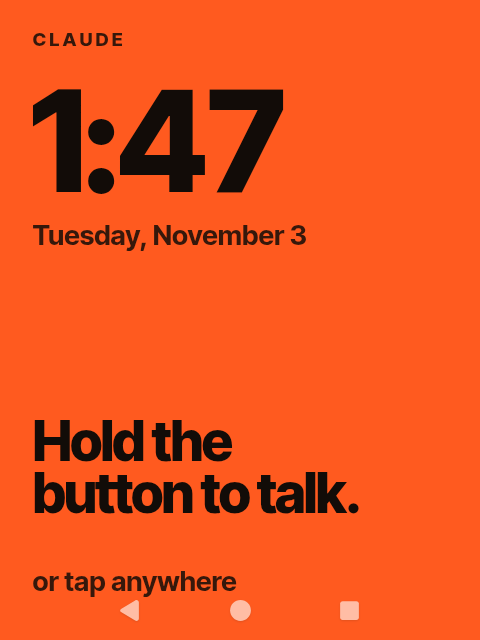
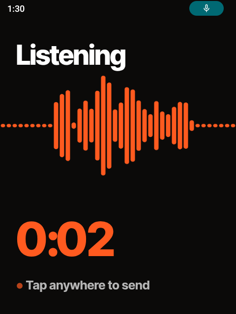

# Claude R1

Turn a Rabbit R1 into a pocket Claude. Hold the side button, talk, let go: Claude answers out loud, draws a
card on the little screen, and can actually do things on the device.

<p>




</p>

- **Push to talk.** Hold the side button anywhere (even in another app) to talk; let go to send. Or tap the screen.
- **Cards.** Weather, flights, stocks, lists and single facts appear as glanceable cards.
- **Controls the phone.** Opens apps, taps, types, reads notifications, takes photos and describes them.
- **Listens to things.** Podcasts, internet radio and music; playback pauses while you talk.
- **Gmail.** Reads your inbox and writes drafts (never sends), once Gmail is connected to your Claude account (see below).
- **Bluetooth.** Pairs and uses headphones and speakers.
- **Memory.** Remembers what you tell it about yourself across conversations, and always knows the date,
  time and roughly where you are.
- **Senses.** Knows how it's being held (in your hand, lying on a table, face down, walking) from its motion
  sensors, and can buzz you with the vibration motor.
- **Lives in Claude.** Claude is the home screen and the lock screen; waking the R1 lands in Claude.

It runs real [Claude Code](https://claude.com/claude-code) on the device (in Debian inside Termux), so you need
a Claude subscription that includes Claude Code.

> [!WARNING]
> Step 1 unlocks the bootloader and replaces the R1's software. It **erases the device**, voids whatever
> support you had, and can brick it if something goes wrong. Make a full backup first (mtkclient can dump
> every partition). You do this at your own risk.

## What you need

- A Rabbit R1 and a USB-C cable
- A Mac or Linux computer with `adb`, `fastboot`, `python3`, `curl` and `unzip`
- The launcher app: download `claude-r1.apk` from the
  [latest release](https://github.com/dennisonbertram/claude-r1/releases/latest) and pass
  `--launcher-apk claude-r1.apk`, or build it yourself with the Android SDK (platform 34, build-tools 34) and JDK 17.
- A Claude account with Claude Code (Pro or Max)
- Optional but strongly recommended: an [ElevenLabs](https://elevenlabs.io) API key, for a natural voice and
  accurate speech recognition
- Wi-Fi

## 1. Unlock the R1 and install Android

1. Follow [r1_escape](https://github.com/RabbitHoleEscapeR1/r1_escape) to enable OEM unlocking, unlock the
   bootloader and disable verified boot (it flashes a disabled `vbmeta`).
2. Instead of r1_escape's AOSP 13 image, flash an **Android 14 GSI**. Claude R1 is developed on the
   LineageOS 21 GSI by AndyYan (`lineage-21-...-arm64-bvN`, the vanilla build without Google apps):

   ```sh
   fastboot reboot fastboot            # userspace fastboot (fastbootd)
   fastboot flash system lineage-21-...-bvN.img
   fastboot -w                         # wipe data
   fastboot reboot
   ```
3. On the R1, finish Android's setup, connect to Wi-Fi, then enable **Developer options → USB debugging**
   (Settings → About → tap *Build number* seven times). Connect it to your computer and accept the prompt.
   `adb devices` should list it.

## 2. Install Claude R1

```sh
git clone https://github.com/dennisonbertram/claude-r1 && cd claude-r1
./install.sh --timezone America/New_York
```

`install.sh` downloads Termux, Shizuku and KISS, builds and installs the Claude launcher, makes it the home
screen and the assistant (so holding the side button opens Claude), turns off the lock screen, starts Shizuku,
copies the rest to the R1 and starts part 2 in Termux.

## 3. Finish on the R1

Part 2 runs in Termux (if it doesn't start by itself, type the command `install.sh` printed). It installs Debian
and Claude Code, then asks you:

1. to **allow Termux** in the Shizuku app (open Shizuku if nothing pops up),
2. for your **ElevenLabs key** (optional) and your **home city** (used for weather and places),
3. to **log in to Claude** — log in, then type `/exit`.

Then hold the side button and ask something.

### Connect your email

Claude can read your mail and write drafts. It never sends, deletes or archives anything; drafts wait in your
mailbox for you to send. There are two ways to connect it:

- **Gmail through your Claude account (easiest).** At [claude.ai](https://claude.ai) → Settings → Connectors,
  connect **Gmail**. Claude Code on the R1 is logged into the same account, so it can use it right away.
- **Any mailbox over IMAP.** For other providers, or if you'd rather not connect Gmail to Claude: create an
  *app password* with your provider (Gmail: Google Account → Security → App passwords; iCloud, Outlook, Yahoo
  and Fastmail have them too) and give it to `termux/setup.sh` when it asks about email. It's stored only on the
  R1, in `~/.config/r1/email.json`. To add it later, run `bash /sdcard/Download/claude-r1/termux/setup.sh` again.

Then ask "what's new in my inbox?" or "draft a reply to Sam saying I'll be late".

## Using it

| You do | It does |
|---|---|
| Hold the side button, talk, let go | Asks Claude (from anywhere, even another app) |
| Hold the button without talking | Just brings you back to Claude |
| Tap the screen | Talk / send / stop Claude talking and reply |
| Hold a finger on the screen | Menu: Start over, Apps, Settings, Terminal |
| Double-press the side button | Camera; the photo shows up in Claude with a description |
| Scroll wheel | Scroll a long answer; on a card, show its details |
| Tap the ♪ title at the top | Pause / resume what's playing |

Things to try: "What's the weather this week?", "Play the latest episode of The Daily", "Play some jazz",
"What's new in my inbox?", "Take a picture and tell me what it is", "Pair my headphones", "Use a female voice",
"Remember that my sister Maya lives in Boston", "How am I holding you?", "Buzz me twice".

## After a reboot

Shizuku (which lets Claude control Android and watch the side button) doesn't survive a reboot. Plug the R1 in
and run:

```sh
./install.sh --start-shizuku
```

Until then Claude still talks and answers, but can't operate the phone, and the side button only opens Claude
(it stops listening when you pause instead of when you let go). The top of the screen shows *Enable phone controls*.

### Or restart Shizuku without a computer (optional)

```sh
./install.sh --shizuku-boot
```

then once on the R1: Settings → Developer options → **Wireless debugging** on, open Shizuku →
**Start via Wireless debugging** → **Pairing**, and enter the code from *Pair device with pairing code*.

After that, when the Claude screen shows **Enable phone controls**, tap it, tap **Start** in Shizuku, and allow
wireless debugging when Android asks. Claude R1 switches wireless debugging off again shortly after Shizuku is up.

Shizuku also tries to start this way by itself at boot, but on the R1 that usually fails: its boot starter runs
before Wi-Fi has connected, and Android won't enable wireless debugging without a network.

> [!CAUTION]
> While wireless debugging is on, adb is reachable from your Wi-Fi network. On GSI builds where adb doesn't ask
> for authorization (`ro.adb.secure=0`, common on userdebug images) anyone on that network could connect. Claude R1
> keeps the window short, but only use this on networks you trust, and leave *Always allow on this network* unticked
> unless you understand the trade-off.

## Settings

Files in Termux's `~/.config/r1/`:

| File | What |
|---|---|
| `elevenlabs_key` | ElevenLabs API key (speech in and out) |
| `voice_id` | ElevenLabs voice (Claude changes it when you ask for another voice) |
| `home_location` | Your home city, the default for weather and places |
| `claude_model` | Claude model for the voice assistant (default `claude-haiku-5-5`, fastest) |
| `memory.json` | What Claude remembers about you |
| `email.json` | IMAP email account (address + app password), if you set one up |
| `mcp_token` | Secret between Claude and the Android tools; created automatically |

## How it works

```
side button / screen ──▶ launcher (ai.r1.claude, a WebView home + assistant app)
                              │  http://127.0.0.1:8765
                              ▼
                      voice-server (Termux, Python)
        mic → ElevenLabs Scribe → Claude Code (Debian, stream-json) → ElevenLabs TTS → speaker
                              │                  │
                              │                  └─▶ android-mcp (127.0.0.1:8766): screen, apps, camera,
                              │                       cards, podcasts, radio, Bluetooth, memory…
                              └─▶ mpv (podcasts, radio)          via Shizuku's shell (rish)
```

- `launcher/` — the Android app: full-screen WebView, starts the voice server through Termux, is the home
  screen and the assistant, comes to the front when the screen turns on.
- `termux/bin/voice-server` — recording, transcription, the Claude session, speech, the UI's state, push-to-talk,
  the camera folder watcher, the media player.
- `termux/bin/android-mcp` — Claude's tools, as an MCP server.
- `termux/share/voice-ui/` — the screen (one HTML file).

## Development

```sh
python3 -m unittest tests/test_voice_server.py tests/test_android_mcp.py
node tests/ui/answers.test.mjs && node tests/ui/flow.test.mjs     # needs Google Chrome
```

`tools/r1-say.sh --ptt "question"` asks the R1 a spoken question as if you held the button (handy for testing
over USB), `tools/r1-state.sh` prints what the screen shows, `tools/r1-card.sh` puts a card on screen.

## Credits

- [r1_escape](https://github.com/RabbitHoleEscapeR1/r1_escape) for unlocking the R1
- [Termux](https://termux.dev), [proot-distro](https://github.com/termux/proot-distro),
  [Shizuku](https://shizuku.rikka.app) (rish), [KISS launcher](https://kisslauncher.com) — downloaded at
  install time, not bundled
- LineageOS GSI by AndyYan
- [Inter Tight](https://github.com/rsms/inter) (SIL Open Font License), bundled in `termux/share/voice-ui/fonts`
- Speech by [ElevenLabs](https://elevenlabs.io); podcast search by the Apple Podcasts directory; radio from
  [radio-browser.info](https://www.radio-browser.info)

MIT licensed (see `LICENSE`). Not affiliated with Rabbit Inc. or Anthropic.
